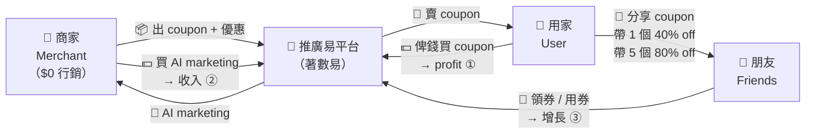

# 推廣易 / 著數易 平台概念摘要

日期：2026-10-16（2026-10-31 更新 Phase 1 同市場分析）。來源：與 turbo 公司傾談後整理。

## 一句定位

**推廣易 = 著數易嘅「帶客引擎」：商戶出 link，人人可分享，帶到客自動分佣。**

- 著數易負責「優惠庫存 + 核銷 + 佣金」——已經有，唔好重造。
- 推廣易負責「分享 + 回贈 + 任務」——把每個 coupon 變成一條可追蹤嘅 share link。

## 平台定位

一個連接「商戶 / 企業」同「個體用戶」嘅推廣平台。核心唔係「幫用戶慳錢」（cashback），而係「幫用戶賺錢」（分享分佣）。用 Membership + Share Link + Cash Rebate 驅動用戶，類似 Uber 式 mission-driven 生態，最終連接返「著數易」。

## Phase 1（優先做）— 個體用戶 + 輕量商戶

### 功能（四塊）

**1. 個體用戶**

- 付月費成為會員，解鎖更多/獨家著數 + 更高回贈比例。
- 拎一條自己專屬嘅 share link（帶自己 tracking ID）。
- 朋友經 link 領券/用券 → 自己賺 rebate 或積分。
- Mission 任務：分享 / 使用 / 邀請 → 儲 rebate 或積分。

**2. 輕量商戶**

- 出一條「人人用得」嘅 Share Link（對方唔使係會員）。
- 可揀：掛住著數易現有 coupon。
- 睇到邊個用戶帶咗幾多客（referral 報表）。

**3. 連接著數易（Phase 1 最關鍵）**

- 著數易 coupon → 掛 tracking → 變成推廣易 share link。
- 用戶經 link 領券/用券 → 記錄 referrer → 觸發 rebate。
- 復用著數易現有嘅核銷、佣金、積分邏輯，唔好重造。

**4. Cash Rebate / Mission 機制**

- 回贈先以**積分**行（喺著數易消費用），Phase 2 先開放現金出金（避開 KYC / 支付 / 合規）。
- Mission 引擎：完成任務 → 自動發回贈。

### Referral 機制詳細設計（參考 Friendbuy）

Friendbuy 係海外 referral/loyalty SaaS，佢哋嘅機制可以直接套落推廣易。核心三件：**獎勵儀表板 + 里程碑階梯 + 抽獎券**。

**1. 獎勵儀表板（用戶追蹤自己嘅 reward）**

每筆 rebate 都寫明狀態 + 原因（白話）：

- 已入賬 / 凍結（等條件達成）/ 被拒（寫明點解）。
- 例：「等緊退貨窗關閉」「朋友唔係新客」「未到里程碑」。
- Dashboard 睇到每條 share link 帶咗幾多客、每個客咩狀態（領券 / 核銷 / 退咗）、每筆 rebate 咩狀態。

**2. 里程碑階梯（Milestone）**

里程碑 bonus 係「額外」加喺每單 referral 之上，唔係取代；有條件 gating（核銷成功 + 過退貨窗 + 朋友係新客先計數）。

| 累計帶客 | 獎勵 | 條件 |
|---|---|---|
| 每 1 個客 | 固定 rebate（$10 / 積分） | 到店核銷 + 過退貨窗 |
| 帶 3 個 | 額外 bonus | 達成里程碑自動發 |
| 帶 10 個 | 更大 bonus + 解鎖高級會員 | 同上 |
| 帶 25 個 | 入大抽獎 / 實體獎品 | 同上 |

永遠 show 進度條：「你仲差 X 個客就到下一個里程碑」。

**3. 大抽獎（抽獎券機制）**

Friendbuy 本身冇抽獎，但著數易已有每週大抽獎。最順做法：**每個里程碑 / 每 N 個客 → 送 1 張抽獎券，自動入返著數易每週抽獎**，唔使自己起多個抽獎系統。

**4. 任務進度（Challenges）**

多步任務 + 進度，完成先獎。例：「分享 5 次（2/5）」「邀請 3 個朋友（1/3）」。

**5. VIP 等級（Tiers）**

按累計帶客量 / 積分分級，每級有唔同回贈 % + 獨家著數，升級即刻推通知。

**6. 到店 QR / Wallet Pass**

個人 referral QR code 放喺錢包 pass，面對面推薦即刻變可追蹤 referral——啱晒到店實體消費場景。

**7. 防假（Fraud）**

自己帶自己唔計、突然爆量要 hold 落嚟 review、退款要 reverse。

> 以上階梯數字（$10 / 3 / 10 / 25）係示例，要按單位經濟再定。

### 商業模式

三條收入 + 一個增長引擎：

1. **賣 coupon**（主要 profit）：平台把優惠變商品賣俾用家，用家俾錢買 coupon。
2. **AI marketing**（額外收入）：向商家賣 AI 推廣 / 虛擬偶像 / 短視頻服務。
3. **分享折扣引擎**（增長引擎，見下）：用戶 share coupon 俾朋友攞更深折扣 → 病毒式免費獲客。

### 分享折扣引擎（Share-to-Unlock）— 病毒式增長

平台唔止賣 coupon + AI marketing，核心增長機制係：**用戶分享 coupon 俾朋友，自己攞更深折扣**。

買 coupon 嘅折扣係「動態」嘅，取決於帶咗幾多朋友：

| 帶客數 | 自己買 coupon 折扣 |
|---|---|
| 0（自己買） | 20% off |
| 帶 1 個朋友 | 40% off |
| 帶 5 個朋友 | 80% off |

> 以上數字係示例，要按單位經濟再定。

**點解有效**

- **自利式病毒循環**：用戶為咗更平，會主動 share——每 share 一次 = 平台免費獲客一次。
- 用「折扣」做誘因直接促進領券 + 核銷，唔使平台先俾現金 rebate。
- 同原有 referral rebate 互補：share 攞折扣（自己慳）+ 帶客賺 rebate（自己賺），兩個都拉同一個動作——分享。

**要留意**

- 80% off 深折扣要計清楚單位經濟，唔好蝕住做（可限制喺指定商戶 / 指定 coupon / 指定時段）。
- 防「自己帶自己」：用 device / 賬號去重，假 referral 唔計數。
- 折扣階梯可結合 VIP 等級（見上 Referral 機制），升級即解鎖更深折扣。

### Phase 1 明確唔包

- AI 寫 post（文字）→ 移去 Phase 2。
- 現金出金 → Phase 2（先積分）。
- 商戶 / 企業會員功能 → Phase 2。

## Phase 2（之後做）— 商戶 / 企業端

- 商戶 / 企業會員功能。
- AI Marketing 生成工具：自動生成推廣內容。
- 幫商戶出 Post（文字先行）：針對公眾號 / 社交媒體 post，AI focus 去 target audience 同 user segment。
- 整合所有 Social Media 成效：集中睇 engagement、reach、conversion。
- 現金出金（回贈可提現）。

## 市場 / 競爭

### 市場分三類

**① Cashback — 你自己消費、自己慳（同推廣易「似而不同」）**

| 玩家 | 做乜 | 同推廣易嘅分別 |
|---|---|---|
| ShopBack / ShopBack Pay（SG→HK） | 主打**網購返現**（e-commerce）；ShopBack Pay 想入到店，但都係消費返現 | 回贈俾**買家自己**，唔係俾帶客者；冇商戶 share link；唔連 coupon 庫存 |
| Rakuten | 海外網購返現 | 同 ShopBack 同類 |

**② 分享分佣 — 你分享、人哋買、你賺（推廣易真正嘅賽道）**

| 玩家 | 做乜 | 狀態 |
|---|---|---|
| 淘寶客 / 京東聯盟 | 分享 product link，朋友買咗分佣 | 大陸成熟，但係電商，唔係到店 |
| 美團「分享得紅包」 | 分享店/券，朋友用咗拎返現 | 大陸成熟，**到店場景**，最接近推廣易 |
| 拼多多（砍價/拼團） | 病毒式 share-to-earn | 大陸 |
| ReferralCandy / Friendbuy / Smile.io | SaaS 幫商戶開 referral program | 海外 B2B 工具，唔係 consumer 平台 |
| **香港 consumer 級分享分佣** | —— | **藍海，冇人做** |

**③ KOL 撮合 — 搵人寫 post**

Look4KOL、HK-KOL、Collabstr、Kolr、AnyTag。呢啲係「花錢請一個人寫 post」，唔係「人人分享、人人分佣」。

### ShopBack 對比

| | ShopBack / ShopBack Pay | 推廣易 |
|---|---|---|
| 回贈俾邊個 | 買家自己 | **分享者 / 帶客者** |
| 核心動作 | 消費 + 付款 | 分享 link + 帶客 |
| 消費場景 | 網購為主（online e-commerce） | **到店實體消費**（in-person） |
| coupon 庫存 | 冇 | **直接連著數易**（領券→核銷→分佣） |
| 商戶 share link | 冇 | 有（商戶出一條，人人用得） |
| mission / 任務 | 冇 | 有（Uber 式任務） |
| 變現 | 商戶佣金抽成 | 會員費 + 商戶佣金再分配 |

**結論：ShopBack 係「慳錢工具」（主打網購），推廣易係「賺錢引擎」（到店實體消費）。** 場景同用戶心理都唔同——ShopBack 喺 online 慳自己嘅；推廣易係到店消費 + 分享分佣，即「順手幫人 + 自己有得袋」。

### 藍海位同風險

- **藍海**：香港 consumer 級「分享 coupon → 到店核銷 → 帶客者自動分佣」，仲要連住一個已有 coupon 平台（著數易）。目前冇人咁做。
- **風險 1**：ShopBack 有錢有用戶，加個「share link referral」就係最大威脅。佢哋核心係網購返現，到店 + 餐飲 + coupon 分銷係未深耕位——係「時機」優勢，唔係護城河。
- **風險 2**：市場研究信心中等。ShopBack 細節靠公開資料（geo-block，未能 live 驗證）。

## 新增目標客群：內地旅客來港消費

除咗香港本地用戶，加多一個重點 target：**內地旅客來港消費**。

### 點解值得做

- 內地旅客係香港最大外來消費群：零售、餐飲、旅遊、藥妝、奢侈品。
- 佢哋本身習慣「領券 → 核銷 → 返現」玩法（美團、大眾點評、抖音團購），教育成本接近零。
- 香港 coupon 對佢哋有吸引力：匯率 + 優惠 + 到店場景。
- 可以直接對接內地成熟平台，唔使由零教育用戶。

### 宣傳策略：點樣 reach 內地旅客

**1. AI Video Promoter App（AI 短視頻批量宣傳）**

- AI 自動生成短視頻：優惠內容 + 香港門店 + 到店路線，一條 coupon 自動變 N 條片（唔同口吻 / 版本 / 平台尺寸）。
- 批量投去抖音、小紅書、視頻號。
- 商戶唔使自己拍片，平台幫佢出片——同「商家 $0 行銷」定位一致。

**2. Create an AI Idol（虛擬偶像帶券）**

- 打造平台專屬 AI 偶像（虛擬 KOL），24/7 直播帶券 / 帶貨，成本遠低過真人 KOL。
- 可同時分身去多個直播間 / 多條片，成為「著數易 / 推廣易」嘅品牌代言，內地旅客認得佢就夠。

**3. Thread 內容營銷（網上數碼營銷）**

- 注意：如果「thread」指 Threads app，內地係 block 咗，target 內地人要用返 **小紅書筆記、抖音話題、微信公眾號 / 視頻號、大眾點評**。
- 核心做法：AI 批量生成「香港攻略 + coupon 連結」內容串（食咩 / 買咩 / 點慳），軟性種草帶券。
- 小紅書「香港探店 / 香港攻略」本來就係內地旅客決策入口，係最應該食嘅位。

### 落地注意

- 內地用戶要用 **微信 / 支付寶登入**（唔好用香港手機號做門檻）。
- 支付：內地旅客用 Alipay / WeChat Pay 已經喺香港通行，核銷無障礙；Phase 1 用積分，唔使現金出金。
- 跨境合規：內容審查 + 數據出境，要按內地法規處理。

## 宣傳方向：時事熱點 + 香港情懷

App 內容營銷嘅核心打法：**蹭時事熱點 + 打香港情懷牌**。兩樣都係香港人（同內地旅客）最 buy 嘅情緒入口。

### 點解有效

- **時事熱點**：跟住每日 trending，內容自帶流量，用戶會主動睇 / 主動 share。
- **香港情懷**：集體回憶（舊冰室、霓虹、港產片、屋邨）係香港最強情緒按鈕，亦係內地旅客對「香港」嘅想像（港片 / 港式文化）。
- 兩者合一：**用情懷做包裝，用時事做時機**——同一條 coupon，撞正熱話就爆。

### 點樣執行（AI 自動生成）

AI 內容引擎每日 scan 香港熱話（新聞 / 社交 trending），自動配對相關商戶 coupon，生成「時事 + 情懷」內容：

| 觸發（時事熱話） | 配對 coupon 例子 |
|---|---|
| 天氣熱（最暖 10 月 / 厄爾尼諾） | 舊式冰室紅豆冰、雪糕、凍檸茶 |
| 經濟好（GDP 5 年最強） | 「慶祝」消費、加碼折扣 |
| 娛樂熱話（尖沙咀事件） | 尖沙咀商圈餐飲 / 零售 |
| 機場奪「全球最佳機場」 | 旅客離港前消費、手信 |
| 懷舊題材（香港舊日常 A–Z） | 老字號、舊區小食、霓虹景點 |

> 上面觸發例子取自 2026-11-01 快照；時事要每日更新，唔係 fixed 清單。

### 情懷主題庫（長期可用）

- 舊式冰室 / 茶餐廳、港式奶茶檸茶、大排檔。
- 街頭小食：魚蛋、雞蛋仔、格仔餅、砵仔糕。
- 霓虹招牌、舊屋邨 / 唐樓、天星小輪、電車（叮叮）。
- 港產片 / 經典廣告對白 / 麥兜。
- 老字號商戶（幾十年歷史嗰啲）→ 直接做「情懷 coupon」。

### 注意

- 時事要**快**：熱話 24–48 小時內就要出內容，遲咗就冇流量 → AI 自動生成係必要，唔係 nice-to-have。
- 情懷要**真**：揀真係有故事嘅老字號 / 場景，唔好硬砌，否則反效果。
- 內地旅客照用同一套：佢哋對「香港情懷」嘅想像（港片、霓虹、港式美食）本身就好強，但角度要揀「旅遊攻略」式。

## 商業計劃 (Business Plan)

### 執行摘要

推廣易 = 著數易嘅「帶客引擎」：商戶 $0 出錢做 marketing，平台把優惠變商品賣俾用家（賣 coupon 賺 profit），再向商戶追加 AI marketing，並用「分享攞更深折扣」令用戶病毒式帶客。Target 香港本地用戶 + 內地旅客來港消費。香港 consumer 級「分享 coupon → 到店核銷 → 帶客自動分佣」係藍海。

### 願景

人人可分享、帶到客就有得賺——把每個香港商戶嘅優惠，變成一條可追蹤、可變現嘅分享鏈。

### 市場機會

- **問題**：中小商戶冇 budget 做 marketing；現有 cashback（ShopBack）只係「自己慳自己」，冇人做「分享分佣」。
- **目標客群**：香港本地消費者（食買玩）＋ 內地旅客來港消費（零售、餐飲、藥妝、奢侈品）。
- **市場規模（粗略）**：香港零售 + 餐飲每年數千億港元；內地訪港旅客消費千億級。起步打頭 100 個商戶 + 1 萬用戶已可驗證模型。
- **藍海**：香港冇人做 consumer 級分享分佣，仲連住一個現成 coupon 平台（著數易）。

### 產品與解決方案

- **用戶**：會員 + 專屬 share link + 分享折扣引擎 + 里程碑 rebate + VIP。
- **商戶**：$0 行銷，出一條人人用得嘅 share link，睇 referral 報表。
- **平台**：連接著數易 coupon 庫存 + 核銷 + 佣金邏輯，唔重造。

### 收入模式（三條線）

1. **賣 coupon** = 主要 profit。
2. **AI marketing**（AI 短視頻 / 虛擬偶像 / 內容營銷）= 額外收入。
3. **分享折扣引擎** = 增長引擎（非直接收入，用折扣換獲客）。

### 增長策略

1. **分享折扣引擎**：0 / 1 / 5 帶客 → 20% / 40% / 80% off，自利式病毒循環。
2. **內地旅客宣傳**：AI Video Promoter App + AI Idol + 小紅書 / 抖音 / 微信內容營銷。
3. **里程碑 + VIP + 抽獎券**：留客、提升 LTV、返單。

### 單位經濟（示例，要按實際數字再計）

假設 coupon 面值 $100：

| 場景 | 用戶俾 | 商戶分成 | 平台毛利 | 備註 |
|---|---|---|---|---|
| 0 帶客（20% off） | $80 | $60 | $20 | 正常利潤 |
| 1 帶客（40% off） | $60 | $50 | $10 | 薄利 |
| 5 帶客（80% off） | $20 | $20 | ~$0 | 當買客成本 |

> 深折扣 = 用毛利換增長。80% off 當獲客成本，真正賺喺復購 + AI marketing + 新客 LTV。呢個係「商家核銷時收唔收返錢」嘅關鍵，要拍板（見關鍵決定）。

### 路線圖

- **Phase 1（3–6 個月）**：香港本地用戶 + 輕量商戶 + 連接著數易 + 積分回贈 + 分享折扣引擎 MVP。
- **Phase 1.5（6–12 個月）**：內地旅客（微信 / 支付寶登入 + 小紅書 / 抖音宣傳 + AI 短視頻）。
- **Phase 2（12 個月+）**：商戶 / 企業會員、AI marketing 全開、現金出金、全渠道整合。

### 風險與對策

| 風險 | 對策 |
|---|---|
| ShopBack 加 share link 抄襲 | 搶時間食到店 + coupon 庫存 + 商戶關係，做深唔做闊 |
| 深折扣蝕錢 | 限指定商戶 / coupon / 時段，80% off 計 ROI 先做 |
| 假 referral / 自己帶自己 | device + 賬號去重，爆量 hold 住 review，退款 reverse |
| 內地合規 | 內容審查 + 數據出境按內地法規，用微信 / 支付寶登入 |
| 著數易對接不順 | 第一件事確認 tracking ID 掛 coupon + 核銷回傳 |

### 資源需求（種子期）

- 工程：同著數易對接（tracking + 核銷回傳）1–2 人。
- 商務：拉商戶 + 對接著數易團隊 1 人。
- AI 內容：短視頻 / 虛擬偶像製作 1 人。
- 主要花費：著數易對接、AI 內容製作、內地渠道起量。

## 關鍵決定（要拍板）

1. **回贈出金**：Phase 1 只做積分（建議），定係都要現金？
2. **賬號打通**：推廣易同著數易係咪同一個 login / 同一套用戶數據？（建議係，否則 tracking 會斷）
3. **輕量商戶收費**：Phase 1 免費入門（建議），定係都收？
4. **Share Link 形態**：著數易 coupon 直接掛 tracking，定係推廣易有獨立 link 再嵌 coupon？
5. **回贈比例**：rebate 幾多 % 由平台統一定，定係商戶自己定？
6. **商家核銷分成**：用家買 coupon 嘅錢，核銷時商家收唔收返一部分？（收 = Groupon 賺差價；唔收 = 平台全袋、商家當免費廣告）直接決定平台 profit 條數。

## 下一步建議（可討論）

- 拍板上面 5 個關鍵決定。
- 設計 Cash Rebate + Mission 機制細節（積分點計、任務清單、回贈比例、里程碑階梯數字）。
- 同著數易團隊對接：確認 tracking ID 點樣掛落 coupon、核銷點樣回傳。
- 準備短 Pitch 版本俾其他潛在合作方。

如有需要可再細化任何部分。
